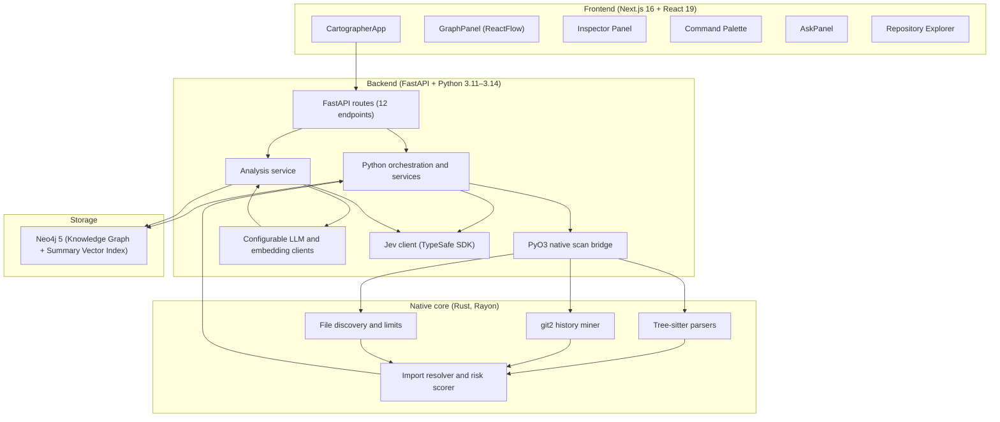
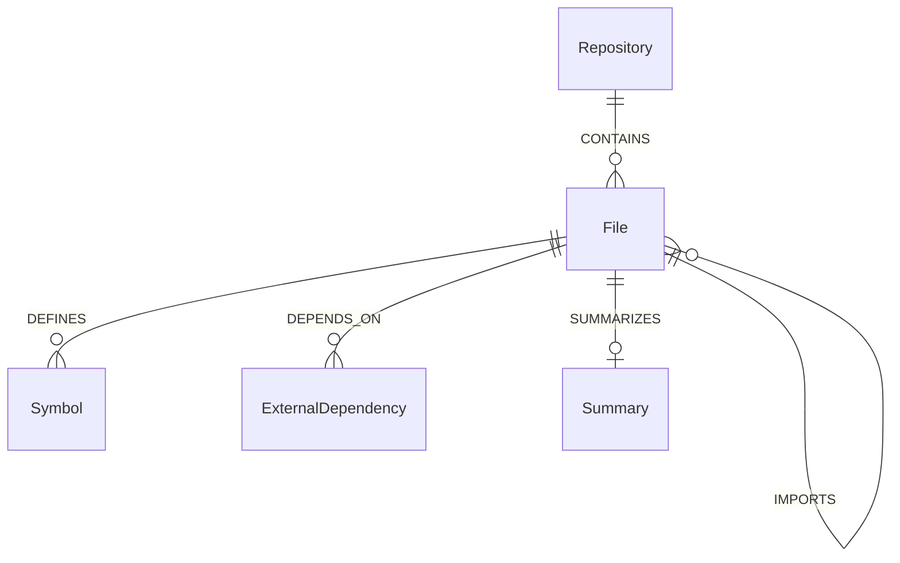
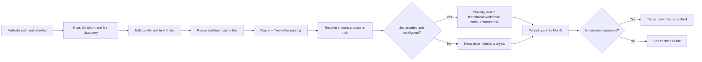
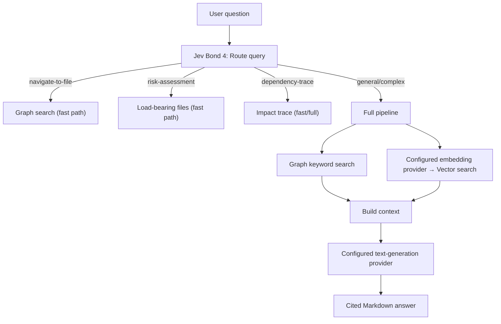
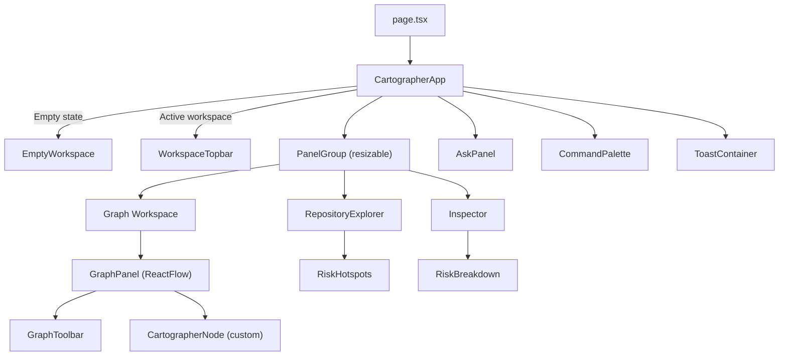

# Architecture

Codebase Cartographer is a three-tier application (Next.js frontend → FastAPI backend → Neo4j graph database) for structural forensics on source repositories. Python coordinates the API and services; a native Rust extension performs file discovery, parsing, Git history analysis, import resolution, and deterministic risk scoring. Jev and configurable Gemini/Ollama providers enrich that deterministic graph.

---

## System Overview



---

## Container Deployment

The root `docker-compose.yml` runs the frontend, backend, and Neo4j as separate services:

| Service | Container port | Host publication |
|---|---:|---|
| Frontend | `5173` | Loopback by default |
| Backend | `8000` | Loopback by default |
| Neo4j Browser/HTTP | `7474` | Loopback only |
| Neo4j Bolt | `7687` | Loopback only |

Within Compose, the backend connects to Neo4j at `bolt://neo4j:7687` and scans the repository mounted read-only at `/workspace`. Neo4j and backend health checks gate dependent service startup. Set `HOST_BIND=0.0.0.0` only when intentionally exposing the frontend/backend beyond the host; set a strong `API_TOKEN` and restrict `CORS_ORIGINS` before doing so. The backend image builds the native Rust extension into a wheel and installs that wheel in the runtime image.

---

## Knowledge Graph Schema

All repository data is stored in a Neo4j property graph. The schema uses five node types and five relationship types. Vector dimensions are configurable; the default is 768.

### Node Types

| Node | Key Property | Description |
|---|---|---|
| `Repository` | `root_path` (unique) | A scanned repository. Stores `name` and `indexed_at` timestamp. |
| `File` | `key` (unique, `{root_path}:{path}`) | A source file. Stores 20+ properties including LOC, complexity, churn, risk score, content hash, and all Jev-derived metadata (architectural role, framework, test detection, dead code, semantic risk). |
| `Symbol` | `id` (unique, `{root_path}:{file}:{name}:{line}`) | A function, class, or async function. Stores name, kind, signature, line range, and complexity. |
| `ExternalDependency` | `name` (unique) | An unresolved import target (third-party package). |
| `Summary` | `key` (unique, `{root_path}:{path}`) | An AI-generated file summary. Stores text, embedding vector, model, provider, and timestamp. |

### Relationships



| Relationship | Source | Target | Properties |
|---|---|---|---|
| `CONTAINS` | Repository | File | — |
| `DEFINES` | File | Symbol | — |
| `IMPORTS` | File | File | `target` (original import string), `line_number`, `source` |
| `DEPENDS_ON` | File | ExternalDependency | — |
| `SUMMARIZES` | File | Summary | — |

### Indexes

| Index | Type | Purpose |
|---|---|---|
| `repo_path` | Uniqueness constraint | Repository identity |
| `file_key` | Uniqueness constraint | File identity |
| `symbol_id` | Uniqueness constraint | Symbol identity |
| `summary_key` | Uniqueness constraint | Summary identity |
| `file_score` | B-tree index | Fast risk-score ordering |
| `file_arch_role` | B-tree index | Architectural role queries |
| `file_risk` | B-tree index | Semantic risk score queries |
| `file_framework` | B-tree index | Framework filtering |
| `summary_embedding` | Vector index (cosine, configured dimensions; default 768) | Semantic similarity search |

---

## Scan Pipeline

The scan request passes through Python path validation and orchestration, then the native Rust scanner. After Jev enrichment (when enabled), the route persists the graph to Neo4j. Optional summary generation runs after persistence when requested.



### Step Details

1. **Path Validation**: Python's `validate_repo_path()` ensures the path exists, is a directory, and falls within `ALLOWED_REPO_ROOTS` (if configured).

2. **File Discovery and Limits**: The native `ignore`-crate walker indexes `.py`, `.js`, `.jsx`, `.ts`, and `.tsx` files; it prunes configured generated/vendor directories and rejects symlinks that escape the repository root. `SCAN_MAX_FILES` limits discovered source files.

3. **Git Churn Mining**: Native `git2` traverses up to 500 commits, extracting per-file commit counts and last-modified timestamps. Non-Git directories produce no churn data.

4. **Incremental Cache**: For incremental scans, the scanner loads prior files, symbols, and imports from Neo4j. Matching size and modification time reuses cached parse results immediately; when those stats differ, the scanner hashes the bounded source read and reuses results if the content is unchanged.

5. **Parsing**: Rayon processes discovered files in parallel using thread-local Tree-sitter parsers in Rust. Python uses `tree-sitter-python`; JavaScript/JSX uses `tree-sitter-javascript`; TypeScript/TSX uses `tree-sitter-typescript`. The parsers extract common declarations and imports and estimate structural complexity from control-flow constructs. There is no regex fallback in the active scan path.

6. **Import Resolution**: Builds indexes from discovered files and resolves common Python dotted/relative imports and JavaScript/TypeScript relative imports, extensionless paths, and `/index` conventions. `.mjs` and `.cjs` suffixes are considered during lookup, but those extensions are not discovered as source files.

7. **Risk Scoring**: The native core calculates a deterministic load-bearing score:
   ```
   score = 100 × (0.45 × fan_in_norm + 0.25 × complexity_norm + 0.20 × churn_norm + 0.10 × fan_out_norm)
   ```
   Fan-in is dampened by 0.3× for trivial files (< 30 LOC and complexity ≤ 1) to prevent simple re-exports from outranking genuinely complex modules.

8. **Jev Enrichment (Bonds 1, 3, 8, 10, 2)**: When `JEV_ENABLED` is true and `TYPESAFE_API_KEY` is configured, Jev classifies files, detects tests/frameworks, assesses zero-fan-in dead-code candidates, and enhances semantic risk for files with deterministic scores above 20. Calls use bounded source snippets and configurable concurrency/call budget.

9. **Test Detection (Bond 3)**: Probabilistic detection of test/spec/fixture files. Files with `is_test_probability > 0.6` are flagged and may receive a test category.

10. **Framework Detection (Bond 8)**: Identifies a framework and architectural layer when Jev returns a decision.

11. **Dead-Code Detection (Bond 10)**: Only zero-fan-in candidates are evaluated. Files with `is_dead_code_probability > 0.65` are flagged as likely dead code.

12. **Semantic Risk (Bond 2)**: Files with deterministic score > 20 receive a semantic risk evaluation. When Jev supplies a score, the final score blends 70% deterministic + 30% Jev semantic (normalized from Jev's 1–10 scale to 0–100).

13. **Neo4j Write and Optional Summaries**: The API route persists files, symbols, imports, and external dependencies in batched Cypher operations (`WRITE_BATCH_SIZE = 250`), removes stale graph data, then optionally generates summaries.

---

## Two-Tier AI Strategy

### System One: TypeSafe Jev

The `JevClient` (`jev_client.py`) wraps the `typesafe-sdk` `AsyncTypeSafeClient`. Each call sends a structured `state` dictionary and a `questions` dictionary to the Jev API. Responses are parsed into `JevDecision` objects with typed fields (`answer`, `probability`, `value`, `confidence`, `distribution`).

All 10 bonds share the same `decide()` method:

```python
async def decide(state, questions, timeout=10.0) -> JevResult | None
```

Jev is called only when `JEV_ENABLED=true` and `TYPESAFE_API_KEY` is configured. Scan-time calls use configurable concurrency (`JEV_BATCH_CONCURRENCY`, default 5) and the optional per-scan call budget (`JEV_MAX_CALLS_PER_SCAN`; values ≤ 0 mean unlimited).

### System Two: Gemini / Ollama

The `LLMClient` (`llm.py`) provides two operations:

- **`complete(prompt)`**: Text generation with automatic rate-limit retry (up to 5 attempts with 5s backoff for Gemini 429 errors). It tries the configured primary provider, then fallback provider; defaults are Gemini → Ollama → deterministic fallback.
- **`embed(text, task)`**: Embedding generation for semantic search. It tries the configured embedding provider, then its fallback; defaults are Gemini (`text-embedding-004`) → Ollama (`nomic-embed-text`). If both are unavailable, it returns no embedding.

The deterministic fallback returns a structured message with the raw prompt context, allowing the user to continue analysis without any AI provider.

---

## Query & Analysis Pipeline

### Architecture Questions (`/api/query`)



Jev Bond 4 classifies the user's intent into one of 13 categories and estimates whether generative AI is needed. Simple queries (file navigation, symbol lookup, risk assessment, and some dependency traces) can be answered directly from graph data without a text-generation call. The full path combines keyword graph search with vector search when embeddings are available.

### Impact Analysis (`/api/impact`)

1. **Graph traversal**: Direct and transitive dependents are discovered via variable-depth Cypher path queries (depth 1–6, limit 100 results).
2. **Jev Bond 6**: Evaluates refactor safety — probability of safe single-PR refactor, recommended strategy (8 options from "safe-direct-refactor" to "do-not-refactor-too-risky"), and blast radius score (1–10).
3. **Text-generation narrative**: A Markdown explanation of the change impact using the configured LLM provider and fallback.

### Summary Generation (`/api/summaries`)

1. **Jev Bond 7**: Triages every file to decide if it warrants an LLM call. Files triaged out (probability < 0.5) are skipped. Remaining files are sorted by Jev-assigned priority (descending).
2. **Jev Bond 9**: For files with existing summaries, evaluates whether the summary is stale. Files with `needs_resummarize` probability < 0.4 are skipped.
3. **Summary generation**: Source snippets (up to `SUMMARY_MAX_CHARS`, default 4,000) are sent to the configured LLM provider with a structured prompt.
4. **Embedding**: Each generated summary is embedded with the configured embedding provider when available, then saved with its model/provider metadata in Neo4j. Summaries can still be saved without an embedding.

---

## Persistence & Graph Operations

### Write Strategy

Repository graphs are atomically written within a single Neo4j transaction:

1. `MERGE` the Repository node.
2. `UNWIND` + `MERGE` all File nodes in batches of 250.
3. Delete stale File nodes (and their Symbols/Summaries) that no longer exist.
4. Delete all existing IMPORTS and DEPENDS_ON edges (full refresh).
5. Delete and recreate all Symbol nodes.
6. `UNWIND` + `MERGE` IMPORTS edges (resolved internal imports).
7. `UNWIND` + `MERGE` DEPENDS_ON edges (unresolved external deps).
8. Clean up orphaned ExternalDependency nodes.

### Graph Slice (`/api/graph`)

The graph view returns the top-N files by risk score (default 80, max 400) with their import edges (default 200, max 2,000). It also computes:

- **Directory clusters**: Top-level directory groupings with file count, average score, and max score.
- **Cluster edge counts**: Internal, external-in, and external-out edge counts per cluster.
- **Jev Bond 5**: Rates each cluster's cohesion (1–5), coupling (1–5), and extraction readiness.
- **Truncation metadata**: The client is told whether the graph was truncated and the applied limits.

### Semantic Search

File summaries with non-null embeddings are indexed in a Neo4j vector index (`summary_embedding`, cosine similarity, 768 dimensions). The `/api/query` endpoint embeds the user's question and retrieves the top-6 most semantically similar summaries.

### Scan Cache

For incremental rescans, `scan_cache()` loads the complete previous state from Neo4j: all File nodes with their full property set, all Symbols, and all import/dependency edges. This allows the scanner to skip unchanged files entirely.

---

## Frontend Architecture

### Component Hierarchy



### State Management

All workspace state is managed locally in `CartographerApp` via React hooks — no external state library. The core state atoms:

| State | Type | Purpose |
|---|---|---|
| `activeRepoPath` | `string` | Currently active repository |
| `selectedFile` | `string \| null` | Selected file path (syncs graph ↔ tree ↔ inspector) |
| `fileDetail` | `FileDetail \| null` | Full detail for the selected file |
| `graph` | `GraphData` | Current graph slice (nodes, edges, clusters) |
| `files` | `Array` | Flat file list for the tree view |
| `repositories` | `RepositoryInfo[]` | All indexed repositories |
| `overview` | `{files, symbols, avg_score}` | Repository statistics |
| `RepositoryExplorer.activeView` | `"architecture" \| "risk"` | Switch between the file tree and risk hotspots |
| `impactMode` / `impactData` | `boolean` / `any` | Impact analysis state |
| `question` / `answer` / `semanticMatches` | `string` / `string` / `SemanticMatch[]` | AI Q&A state |

### Key Interactions

- **Universal File Selection**: `selectFile(path, source)` handles selection from any source (graph click, tree click, search result, AI evidence, inspector link). It sets the selected file and fetches full detail from `/api/file-detail`.
- **Graph Rendering**: `GraphPanel` converts raw API nodes into ReactFlow nodes using Dagre for layout. Custom `CartographerNode` components display file name, parent directory, language, LOC, framework, and risk indicators.
- **Graph Filters**: The `GraphToolbar` provides toggles for hiding test files, showing high-risk only, and hiding isolated nodes. Filters are applied client-side over the graph slice.
- **Impact Tracing**: The inspector action calls `/api/impact`; affected dependents are highlighted in the graph and impact/refactor-safety details appear in the inspector.
- **Command Palette**: `Cmd+K` opens a modal with debounced search (300ms). Results show file matches from `/api/search`. The first option always forwards the query to "Ask Cartographer".
- **Workspace Persistence**: The last active repository path is saved in browser local storage and restored on the next visit.

### API Client

The typed API client (`api.ts`) provides:

- Typed interfaces for all API responses (`GraphData`, `FileDetail`, `Overview`, `AskResponse`, etc.).
- A private `request()` function that prepends `NEXT_PUBLIC_API_BASE`, attaches the optional `NEXT_PUBLIC_API_TOKEN` header, and handles errors.
- Helper functions for query string construction (`withRepoPath`, `withQuery`).

---

## API Security Model

| Mechanism | Configuration | Behavior |
|---|---|---|
| **API Token** | `API_TOKEN` env var | When set, all endpoints except `/api/health` require `Authorization: Bearer <token>` or `X-API-Key: <token>`. When unset, other routes are open except destructive `DELETE /api/repositories`, which is disabled unless a token is configured. |
| **Rate Limiting** | `SCAN_RATE_LIMIT_PER_MINUTE` (default 6) | Per-client sliding-window limit on `/api/scan`, `DELETE /api/repositories`, `/api/query`, `/api/impact`, and `/api/summaries`. |
| **Scan Limits** | `SCAN_MAX_FILES`, `SCAN_MAX_FILE_BYTES`, `SCAN_MAX_REPOSITORIES` | Defaults: 10,000 source files per repository, 2,000,000 bytes read per file, and 50 indexed repositories. Values ≤ 0 disable the corresponding limit. |
| **Graph Limits** | Query parameters | `/api/graph` defaults to 80 nodes and 200 edges, capped at 400 nodes and 2,000 edges. |
| **Path Allowlist** | `ALLOWED_REPO_ROOTS` | Comma-separated list of allowed scan roots. When empty, all paths are allowed. |
| **CORS** | `CORS_ORIGINS` (default `http://localhost:5173`) | Configurable origins. Only `GET` and `POST` methods. Only `Authorization`, `Content-Type`, and `X-API-Key` headers. No credentials. The delete route is not enabled for cross-origin browser calls. |

## API Surface

All routes are prefixed with `/api`. The health route is always token-free; other routes use the API-token behavior above.

| Method | Route | Function |
|---|---|---|
| `GET` | `/health` | API and Neo4j health |
| `POST` | `/scan` | Scan or incrementally rescan a repository; optionally generate summaries |
| `GET` | `/overview` | Repository metrics and load-bearing files |
| `GET` | `/repositories` | List indexed repositories |
| `DELETE` | `/repositories?repo_path=...` | Destructively purge an indexed repository; requires configured API token |
| `GET` | `/files` | List indexed file metadata |
| `GET` | `/graph` | Bounded graph slice and directory-cluster data |
| `GET` | `/search` | Search indexed paths, symbols, and dependencies |
| `POST` | `/query` | Answer architecture questions |
| `POST` | `/impact` | Trace dependency impact and estimate refactor safety |
| `GET` | `/file-detail` | Return file metadata, symbols, imports, and dependents |
| `POST` | `/summaries` | Generate or refresh summaries for an indexed repository |

---

## Configuration Reference

Backend configuration is managed via Pydantic Settings, loaded from `.env` files with environment variable overrides. The frontend also reads `NEXT_PUBLIC_API_BASE` and optional `NEXT_PUBLIC_API_TOKEN`; these are browser-facing settings, not backend Pydantic settings. `NEXT_PUBLIC_API_TOKEN` is included in client-side code and must not be treated as a secret.

| Variable | Default | Description |
|---|---|---|
| `LLM_PROVIDER` | `gemini` | Primary LLM provider (`gemini` or `ollama`) |
| `FALLBACK_LLM_PROVIDER` | `ollama` | Fallback LLM provider |
| `GEMINI_API_KEY` | — | Google Gemini API key |
| `GEMINI_MODEL` | `gemini-1.5-flash` | Gemini model for text generation (`.env.example` sets `gemini-2.5-flash`) |
| `OLLAMA_BASE_URL` | `http://localhost:11434` | Ollama server URL |
| `OLLAMA_MODEL` | `qwen2.5-coder:7b` | Ollama model for text generation |
| `TYPESAFE_API_KEY` | — | TypeSafe API key (enables Jev) |
| `JEV_BASE_URL` | `https://api.typesafe.ai` | Jev API endpoint |
| `JEV_MODEL` | `jev-latest` | Jev model version |
| `JEV_ENABLED` | `true` | Master kill-switch for all Jev features |
| `JEV_MAX_CALLS_PER_SCAN` | `0` | Jev HTTP call budget per scan/summary run; ≤ 0 is unlimited |
| `JEV_BATCH_CONCURRENCY` | `5` | Max parallel Jev calls during scan |
| `EMBEDDING_PROVIDER` | `gemini` | Primary embedding provider |
| `FALLBACK_EMBEDDING_PROVIDER` | `ollama` | Fallback embedding provider |
| `GEMINI_EMBEDDING_MODEL` | `text-embedding-004` | Gemini embedding model |
| `OLLAMA_EMBEDDING_MODEL` | `nomic-embed-text` | Ollama embedding model |
| `EMBEDDING_DIMENSIONS` | `768` | Vector index dimensions |
| `SUMMARY_MAX_FILES` | `120` | Max files to summarize per request |
| `SUMMARY_MAX_CHARS` | `4000` | Max source chars sent to LLM per file |
| `SCAN_MAX_FILES` | `10000` | Max source files per repository |
| `SCAN_MAX_FILE_BYTES` | `2000000` | Max source bytes read per file; ≤ 0 disables the limit |
| `SCAN_MAX_REPOSITORIES` | `50` | Max distinct repositories in the graph store; ≤ 0 disables the limit |
| `SCAN_RATE_LIMIT_PER_MINUTE` | `6` | Rate limit for scan, query, impact, summary, and purge endpoints |
| `API_TOKEN` | — | Optional API authentication token |
| `NEO4J_URI` | `bolt://localhost:7687` | Neo4j connection URI |
| `NEO4J_USERNAME` | `neo4j` | Neo4j username |
| `NEO4J_PASSWORD` | — | Neo4j password |
| `ALLOWED_REPO_ROOTS` | — | Comma-separated allowed scan paths |
| `CORS_ORIGINS` | `http://localhost:5173` | Comma-separated allowed CORS origins |
